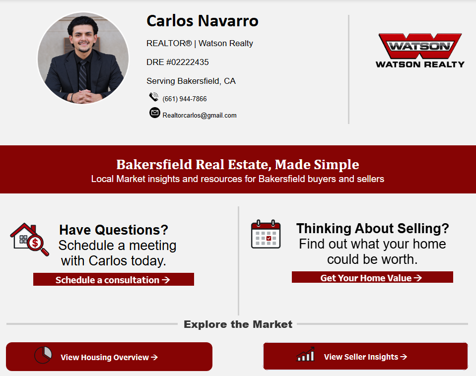
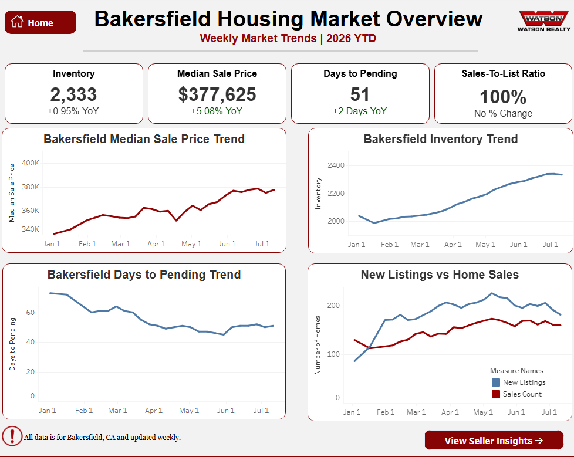
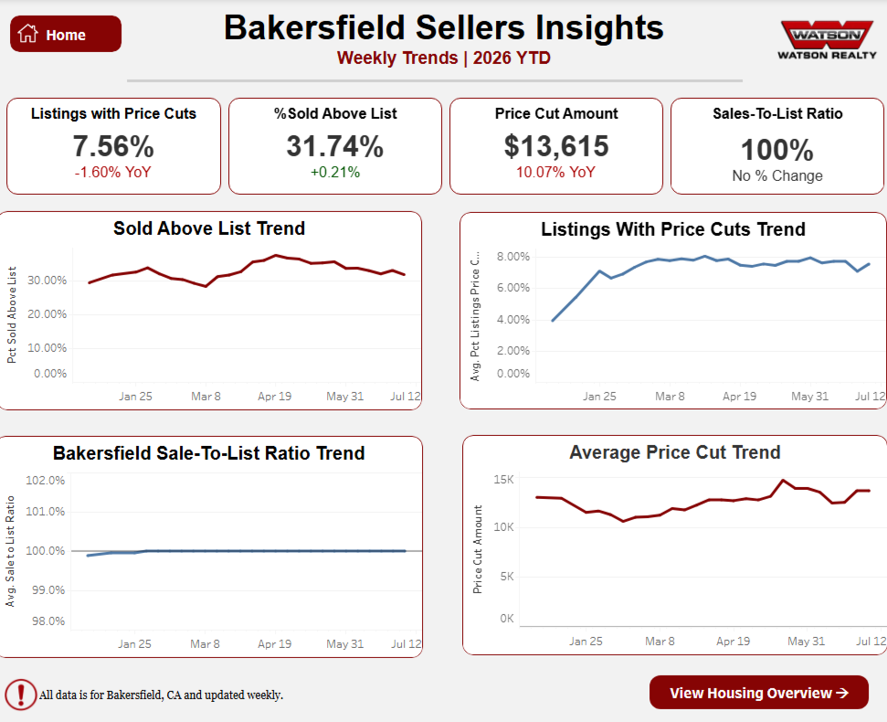

# 🏠 Bakersfield Real Estate Market Analytics

An end-to-end real estate analytics project built with **Python, Pandas, MySQL, SQL, and Tableau** to analyze housing market and seller trends in Bakersfield, California.

This project transforms real estate market data into an interactive, client-facing Tableau experience designed to make local housing market conditions easier to understand and communicate.

---

## 📊 Live Interactive Dashboard

### [➡️ View the Bakersfield Real Estate Dashboard on Tableau Public](https://public.tableau.com/shared/ZKWSJ99NC?:display_count=n&:origin=viz_share_link)

The Tableau project contains three connected dashboards:

- **Landing Page**
- **Bakersfield Housing Market Overview**
- **Bakersfield Sellers Insights**

---

## 🎯 Project Overview

The goal of this project was to build an end-to-end real estate analytics solution that transforms housing market data into actionable and easy-to-understand insights.

The dashboard provides a high-level view of the Bakersfield housing market while also offering seller-focused metrics that help communicate current market conditions.

The project covers the complete analytics workflow:

**Data Collection → Python Cleaning → MySQL/SQL Analysis → Tableau Visualization → Interactive Dashboard**

---

## ❓ Business Questions

The analysis was designed to answer questions such as:

- How are Bakersfield home prices changing over time?
- Is housing inventory increasing or decreasing?
- How quickly are homes going pending?
- How closely are homes selling to their listing prices?
- What percentage of listings are receiving price cuts?
- How large are those price reductions?
- What percentage of homes are selling above list price?
- How do current market conditions compare with the prior year?
- Are market conditions becoming more favorable for buyers or sellers?

---

## 🛠️ Tools & Technologies

| Tool | Purpose |
|------|---------|
| **Python** | Data preparation and cleaning |
| **Pandas** | Data transformation and validation |
| **MySQL** | Data storage and querying |
| **SQL** | Market analysis and data preparation |
| **Tableau** | KPI development, visualization, and dashboard design |
| **GitHub** | Project documentation and version control |

---

## 🧹 Data Cleaning

The real estate datasets were cleaned and prepared using **Python and Pandas** before being used for downstream analysis.

The data preparation stage created cleaned datasets that could be loaded into MySQL, analyzed with SQL, and visualized in Tableau.

The Python data-cleaning workflow is available here:

[`RealEstate_data_cleaning.ipynb`](RealEstate_data_cleaning.ipynb)

### Cleaned Datasets

- [`bakersfield_weekly_market_clean.csv`](bakersfield_weekly_market_clean.csv)
- [`bakersfield_zhvi_clean.csv`](bakersfield_zhvi_clean.csv)

---

## 🗄️ SQL & MySQL Analysis

After data preparation, the cleaned datasets were used for SQL-based analysis supporting the metrics and trends displayed throughout the Tableau dashboards.

The SQL portion of the project demonstrates the transition from cleaned data into structured analysis for business intelligence and visualization.

The SQL file is available here:

[`Bakersfield_market_data.sql`](Bakersfield_market_data.sql)

---

# 📈 Dashboard Preview

## 🏡 Landing Page

The landing page serves as the entry point to the dashboard experience.

It was designed as a client-facing interface rather than simply a collection of charts. Users can navigate to the market dashboards and access real estate calls to action from one central page.



---

## 📊 Bakersfield Housing Market Overview

The **Housing Market Overview** provides a high-level view of current Bakersfield real estate conditions.

### Key Performance Indicators

- Housing Inventory
- Median Sale Price
- Days to Pending
- Sale-to-List Ratio

### Market Trends

- Median Sale Price Trend
- Housing Inventory Trend
- Days to Pending Trend
- New Listings vs. Home Sales

The dashboard also includes year-over-year comparisons to provide additional context around current market conditions.



---

## 💰 Bakersfield Sellers Insights

The **Sellers Insights** dashboard focuses specifically on market indicators that can help evaluate current selling conditions.

### Seller KPIs

- Listings With Price Cuts
- Percentage of Homes Sold Above List
- Average Price Cut Amount
- Sale-to-List Ratio

### Seller Market Trends

- Sold Above List Trend
- Listings With Price Cuts Trend
- Sale-to-List Ratio Trend
- Average Price Cut Trend

The dashboard also incorporates year-over-year KPI comparisons to provide context around changes in seller market conditions.



---

## ✨ Dashboard Features

The Tableau experience includes:

- Interactive dashboard navigation
- Current housing market KPIs
- Year-over-year KPI comparisons
- Weekly market trend visualizations
- Seller-focused market indicators
- Housing market overview
- Client-facing landing page
- Calls to action for real estate inquiries
- Navigation between dashboard sections
- Interactive browser-based Tableau experience

---

## 🔄 Analytics Workflow

```text
Real Estate Market Data
          ↓
    Python / Pandas
     Data Cleaning
          ↓
    Cleaned Datasets
          ↓
      MySQL / SQL
       Analysis
          ↓
        Tableau
   KPI Development &
     Visualization
          ↓
Interactive Client-Facing
       Dashboard
```

---

## 📂 Repository Structure

```text
bakersfield-real-estate-analytics/
│
├── README.md
│
├── RealEstate_data_cleaning.ipynb
│
├── Bakersfield_market_data.sql
│
├── bakersfield_weekly_market_clean.csv
│
├── bakersfield_zhvi_clean.csv
│
├── Landing_Page.png
│
├── Housing_Overview.png
└── Seller_Insights.png
```

---

## 💼 Business Use Case

This project was designed to go beyond exploratory analysis and create a finished analytics product that can communicate housing market information to a non-technical audience.

The dashboards organize market data into understandable KPIs and trends that can be used to discuss Bakersfield real estate conditions with prospective buyers and sellers.

The seller-focused dashboard provides additional context around price reductions, homes selling above list price, and sale-to-list performance, while the general market dashboard provides a broader view of inventory, pricing, market speed, and housing activity.

---

## 🚀 Project Purpose

This project demonstrates my ability to take a data analytics project through an end-to-end workflow:

**Raw Data → Data Cleaning → Database → SQL Analysis → KPI Development → Visualization → Business-Facing Dashboard**

The project demonstrates experience with:

- Cleaning and transforming data with **Python and Pandas**
- Working with structured datasets
- Using **MySQL and SQL** for analysis
- Translating data into business-focused KPIs
- Developing interactive visualizations in **Tableau**
- Designing dashboards for non-technical users
- Creating year-over-year market comparisons
- Building an interactive navigation experience
- Presenting technical analysis as a finished business product
- Documenting and presenting an analytics project through **GitHub**

---

## 🔗 View the Interactive Dashboard

Want to explore the finished project?

### [🚀 Launch the Bakersfield Real Estate Dashboard](https://public.tableau.com/shared/ZKWSJ99NC?:display_count=n&:origin=viz_share_link)

---

## 👤 Author

**Luis Sicairos-Chaidez**

Data Analyst | Tableau Developer

This project is part of my data analytics portfolio demonstrating practical experience with **Python, SQL, MySQL, Tableau, data visualization, dashboard development, and business intelligence**.
